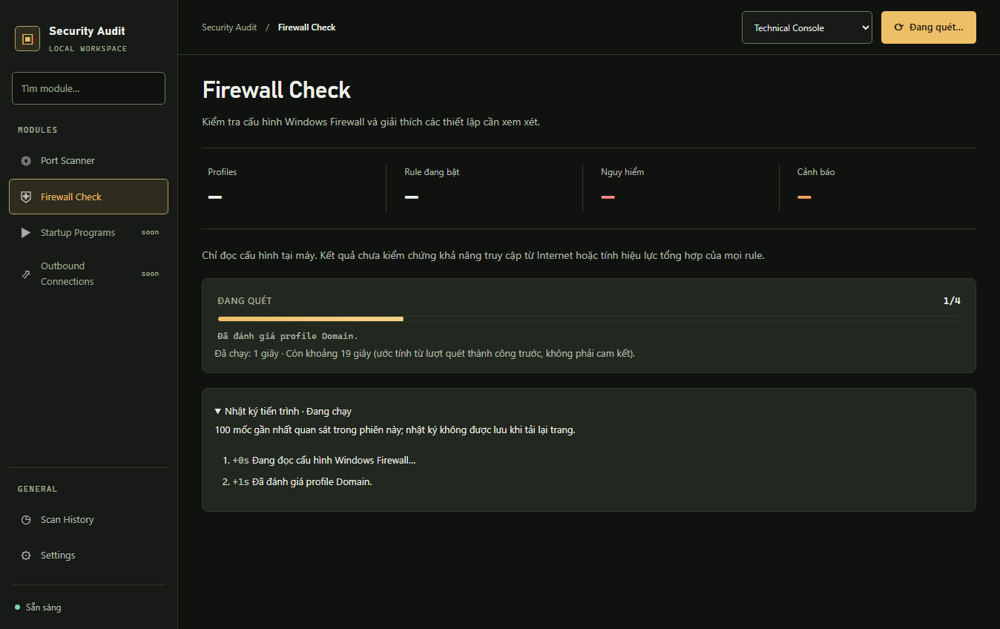

# Firewall Check: bằng chứng sửa lỗi và tiến trình

Ngày: 2026-10-26. Nhánh: `codex/firewall-progress-review`. Trạng thái: hoàn tất kiểm chứng thay đổi; không thay cho kết quả release.

## Phạm vi

[Kế hoạch và phân vai](../../plans/firewall-progress-review.md) ghi contract, rủi ro và checklist. Thay đổi xử lý quét trùng/restart, race khi tải kết quả hoặc mất WebSocket, progress đúng thời điểm, elapsed/ETA và nhật ký hoạt động thu gọn. Không thay đổi chính sách firewall hay tiêu chí phân loại rule.

## Bằng chứng trước sửa

- Firewall: 46 tests đạt trên mã gốc.
- Backend: 271 tests đạt, 101 Selenium tests bỏ qua khi chưa có `--selenium`.
- Regression backend mới tái hiện 6 failures trước sửa; sau sửa phần backend: 51 tests firewall đạt.
- Bốn regression UI bằng HTTP/WebSocket giả tái hiện lỗi trước sửa: progress chưa thể hiện unknown duration, latest response cũ ghi đè, không reconcile khi disconnect, thiếu timing/log.

Tests dùng Python từ `.venv/Scripts/python.exe`, dữ liệu tạm dưới `backend/logs/` và chạy ngoài sandbox khi sandbox không cho fixture hoạt động. Không dùng cấu hình/token/database thật trong fixture mới. Backend có cảnh báo deprecation sẵn có từ Starlette TestClient/httpx; không thay dependency trong task này.

## Kiểm chứng sau sửa

- Toàn bộ backend không bật browser: `python -m pytest -q --basetemp=logs/pytest-firewall-final-backend --tb=short` — **276 passed, 109 skipped**, exit 0 (20,82 giây). Các test bỏ qua là Selenium opt-in tại thời điểm chạy; phần này được chạy riêng bên dưới.
- Full suite từ `backend/`: `python -m pytest --selenium -q --basetemp=logs/pytest-firewall-final-selenium --tb=short --junitxml=logs/firewall-final-selenium.xml` — **386 passed**, exit 0 (608,08 giây). Đối chiếu XML: 276 backend và 110 Selenium, 0 failures, 0 errors, 0 skipped.
- Frontend từ `frontend/`: `pnpm lint` và `pnpm build` — điều phối viên chạy lại trên diff cuối, đều exit 0. Không thêm dependency.
- 9 regression UI giả trong full suite bao phủ unknown progress/ARIA, elapsed/ETA, exact-ID completion, initial response cũ, stale socket/HTTP, disconnect + HTTP outage/retry, 409 recovery, thiếu/vượt mẫu ETA, log gaps, burst 150 mốc giữ tối đa 100 và terminal, reduced motion, POST thành công/thất bại đến sau khi chuyển trang.
- Shared ProgressBar cũng được kiểm chứng qua các ca Port Scanner, themes và navigation có sẵn trong full Selenium. Các ca firewall mới dùng dữ liệu giả; suite cũ có cả kiểm tra đọc firewall trên máy Windows hiện tại.
- `git diff --check` và `git diff --cached --check` đạt. Ảnh phát sinh ngoài phạm vi từ suite cũ được khôi phục; chỉ ảnh dữ liệu giả dưới đây thuộc bàn giao mới.

## Ảnh UI

## Review–fix

Planner GPT-6.1 Sol/high chỉ đọc và bàn giao nguyên nhân/phạm vi. Executor GPT-6.1 Sol/high sửa product code/tests; điều phối viên sửa tài liệu. Reviewer GPT-6 Astra/high kiểm tra độc lập toàn diff.

Vòng 1: reviewer không có finding product/bảo mật cần sửa. Kiểm tra callers, version/scan ID guards, cleanup, polling, 409, khóa trong một process, restart, ProgressBar/CSS/ARIA, bảo toàn collector/classification/auth và tests. Yêu cầu khép khoảng trống kiểm chứng: burst hơn 100 mốc cùng terminal, reduced motion, POST thành công đến sau khi chuyển trang, full backend/Selenium. Executor bổ sung tests; không có sửa product sau review. Reviewer xác nhận assertions bổ sung có ý nghĩa, không có lỗi mới và không cần thêm vòng review–fix. Gate cuối đạt bằng full suite 386 tests; dừng ở vòng 1 trong giới hạn 3 vòng.

## Giới hạn

Collector PowerShell chưa stream từng cmdlet: phần đọc cấu hình có tiến độ indeterminate, không có phần trăm thực. ETA chỉ tham chiếu thời lượng thành công từ trang 20 records mới nhất hoặc kết quả thành công được biết trong phiên; chưa hiệu chuẩn trên nhiều máy và không phải SLA. Nhật ký hoạt động chỉ phản ánh sự kiện frontend quan sát trong phiên; không khôi phục lịch sử đã bỏ lỡ khi tải lại hoặc dùng HTTP fallback. Khóa quét dùng cơ chế một backend process hiện có, không phải khóa phân tán.
