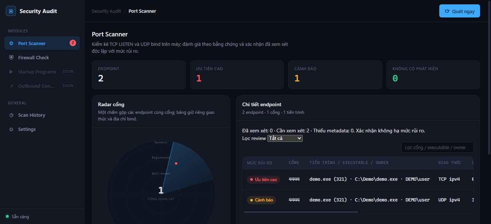

# Port Scanner upgrade — kiểm chứng

Ngày: 2026-10-24. Nhánh triển khai `codex/port-scanner-upgrade`, baseline `de5f27d`. Báo cáo ghi bằng chứng kiểm thử, không phải release; xem Git/PR để xác nhận trạng thái tích hợp. [Kế hoạch/checklist](../../plans/port-scanner-upgrade.md) và [contract/rules](../../architecture/port-scanner-risk.md) là tài liệu liên quan.

## Phạm vi

Endpoint identity v2, nhiều owner, metadata theo trường, mọi risk reasons, review độc lập severity, expiry/suspension, baseline/legacy, transaction và vòng đời scan, API/auth/OpenAPI, React/Settings/History. Không thêm dependency. Không thay collector hay rule Firewall Check.

## Kiểm thử và review

Cách thực hiện: `executing-plans` và TDD cho từng nhóm hành vi; `postman:api-engineer` cho contract/API; một reviewer độc lập theo `requesting-code-review`; `verification-before-completion` và audit liên kết từ `docs-governance` cho bàn giao. Không tạo workspace Postman hoặc publish ra dịch vụ ngoài vì API local đã có FastAPI/OpenAPI và pytest thực thi.

| Gate | Bằng chứng |
|---|---|
| Collector TDD | 13 failed/4 passed trước; 17 passed sau triển khai đầu |
| Pipeline TDD | 8 failed trước; 8 passed sau triển khai đầu |
| Review API TDD | 9 failed trước; tổng 34 test mới đạt sau triển khai đầu |
| Chrome TDD | 3 failed trước; 3 passed sau triển khai đầu |
| Full backend sau sửa review | `python -m pytest -q`: 271 passed, 76 Selenium skipped, 1 cảnh báo thư viện TestClient |
| Frontend | `pnpm lint` và `pnpm build`: exit 0 |
| Full backend + Chrome | `python -m pytest --selenium -q`: 347 passed, 1 cảnh báo TestClient, 551,76 giây; gồm hồi quy Firewall |
| Chrome sau fix Settings cuối | 11 passed, 88,50 giây: mọi case nâng cấp/race và TestReviewPersistence; lint/build chạy lại đạt |
| Tài liệu/diff | Artifact audit: mọi Markdown link local hợp lệ; diff và cached diff checks đạt |
| Preview UI cuối | 1 seeded Chrome test passed (9,05 giây); Radar dùng “cổng quan sát” và nhãn aria tương ứng, lint/build chạy lại đạt |

Full browser run trước sửa cuối có 327 passed/3 failed: nhãn accessibility/cột legacy và test đọc DOM giữa lúc live rows đang đổi. Các test đã cập nhật theo contract mới, không skip lỗi. Test font đọc một DOM snapshot sau khi scan hoàn tất.

Review độc lập một lượt toàn bộ nhánh phát hiện bốn vấn đề Important; từng lỗi đã có test RED trước fix:

- A → partial quan sát B → A: chỉ chặn expiry do vắng mặt, vẫn expiry khi fingerprint đầy đủ đã đổi.
- SQLite lock qua await: commit snapshot/diff/review trước item events; subscriber đọc được snapshot đã commit và có thể ghi transaction riêng.
- Review response cũ ghi đè scan mới: kiểm tra generation ở cả success và error; hai browser cases trì hoãn response đến sau scan mới hoàn tất.
- Sidebar khởi tạo đếm raw risk/ghi đè badge mới: summary module tính review hiện tại, nhận cả zero; dữ liệu khởi tạo không thay badge đã cập nhật. Test Chrome giữ response modules cũ rồi xác nhận cả hai endpoint.

Các yêu cầu được bổ sung trong fix pass: terminal state khi task bị cancel và re-raise; giới hạn progress producer (1.000 endpoint tối đa 22 updates, giữ update cuối); UI phân biệt thiếu quyền/đã thoát/chưa xác định; History dùng endpoint/ưu tiên cao/không có phát hiện; OpenAPI mô tả 409/410. Test mới xác minh IPv6 scope, mapped loopback, owner order/removal và thay đổi risk do cấu hình.

Sau full run, một case Settings bổ sung tái hiện hủy xác nhận nhưng sidebar chưa tăng lại số cần xem. Test timeout RED trước khi sửa; effect refresh module summary theo revision, bỏ response cũ khi unmount/đổi revision, sau đó cả 11 case liên quan đạt. Không chạy lại toàn bộ 347 case sau thay đổi UI cục bộ này; chạy lại tập browser bị ảnh hưởng và lint/build. Tổng test hiện có là 348, không mô tả chúng như một full run 348/348.

Ảnh bàn giao dùng hai endpoint giả TCP/UDP cùng port; không chứa kết quả máy thật. Radar gom số cổng, bảng giữ hai endpoint; caption/aria dùng “quan sát” để không gọi UDP bind là cổng mở.



## Đo fixture

Fixture tổng hợp 1.000 socket, 50 PID, lookup process giả trễ 0,2 ms, 5 lần mỗi phiên bản. Baseline source lấy từ Git `de5f27d`; cùng dữ liệu giả và lookup delay. Đo collector, không đo mạng hoặc máy đang dùng thật.

| Chỉ số | Baseline | Nâng cấp |
|---|---:|---:|
| Inventory queries | 1 | 1 |
| Process objects | 1.000 | 50 |
| Median | 613,081 ms | 63,565 ms |
| Min–max | 592,574–679,817 ms | 61,699–69,563 ms |

Giảm 95% lookup process trong fixture; median khoảng 9,65 lần nhanh hơn trong điều kiện này. Không suy ra SLA hoặc mức tăng tương tự trên Windows thật. Regression fixture kiểm tra call count thay vì đặt thời gian pass/fail theo máy.

## Lệnh tái kiểm chứng

```powershell
cd backend
..\.venv\Scripts\python.exe -m pytest
..\.venv\Scripts\python.exe -m pytest --selenium
cd ../frontend
pnpm lint
pnpm build
```

Selenium dùng Chrome headless, backend/token/SQLite riêng; tests scan flow cũ có thao tác đọc inventory thật trên máy, các case nâng cấp/race dùng snapshot giả để kiểm soát dữ liệu. Log thô và JUnit nằm trong `backend/.pytest_cache/`, không đưa vào tài liệu chia sẻ hoặc Git.

## Giới hạn kiểm chứng

- Review độc lập chỉ đọc, không chạy lại suite; số liệu suite do lượt triển khai thực thi. Không có lượt reviewer thứ hai sau fix; dùng RED→GREEN và regression suite để kiểm chứng sửa lỗi.
- Chưa kiểm thử native inventory đa nền tảng/quyền Administrator, Python patch release khác, nhiều backend process, disk-full/corruption/power-loss. V1 chỉ một backend process/SQLite; rollback và restart được kiểm thử bằng fixture.
- Inventory và metadata là các quan sát theo thời điểm, không phải snapshot OS nguyên tử; tiến trình/socket có thể thay đổi trong lúc thu thập.
- Chưa benchmark end-to-end/history lớn/browser FPS hoặc audit toàn diện accessibility/responsive. Browser tests kiểm tra luồng và text trạng thái; không chứng minh mọi biến thể OS/UI.
- Không active scan, kiểm chứng reachability, Windows Services, chữ ký/binary, CVE hay firewall correlation. Path/user không phát hiện nội dung executable đổi tại cùng đường dẫn.
- Auth/Origin và Firewall chỉ được kiểm tra hồi quy theo suite hiện có; đây không phải một audit bảo mật độc lập toàn hệ thống.
